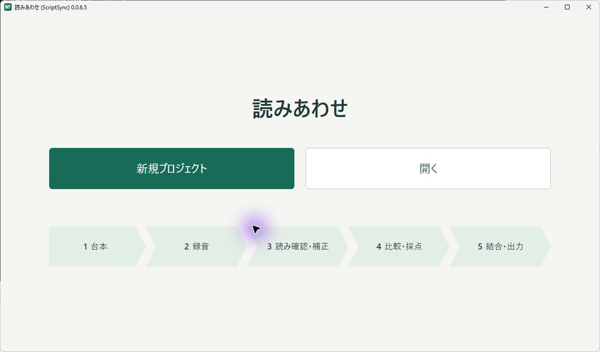
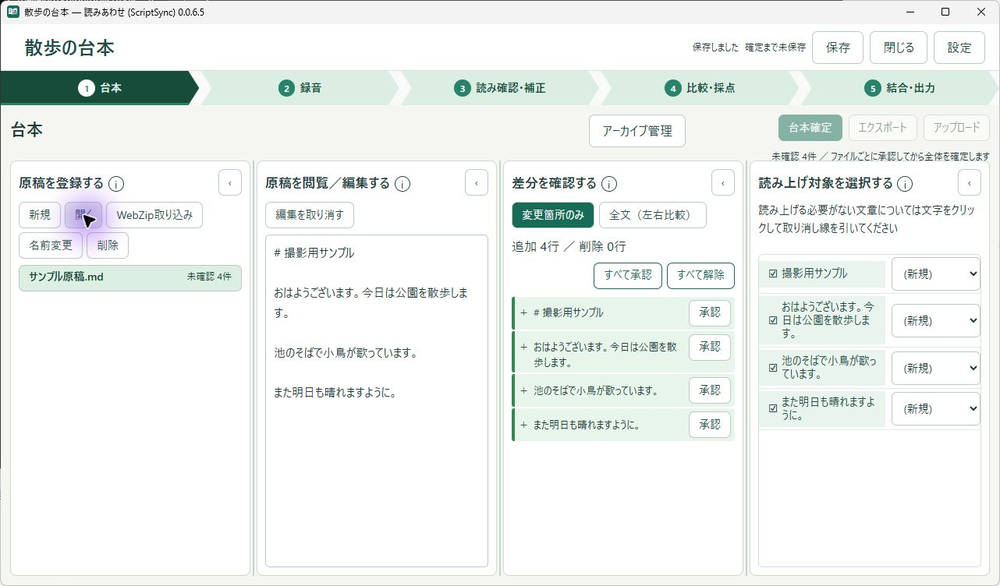
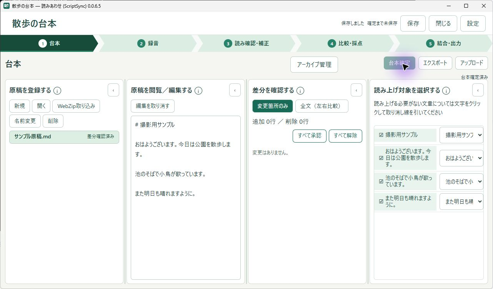
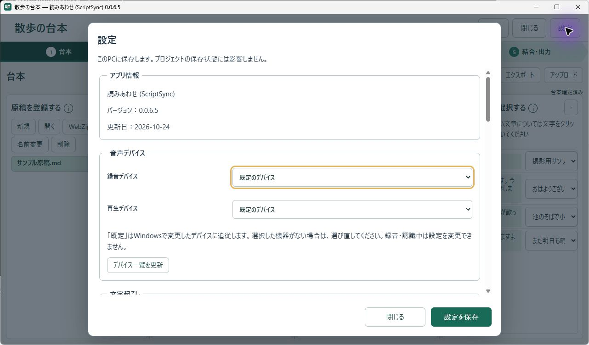
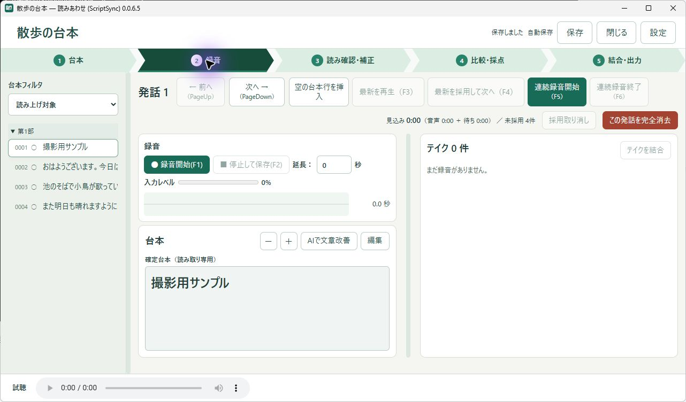

# 読みあわせ (ScriptSync)

Markdownやテキストの原稿を発話ごとに録音するWindows向けアプリです。発話ごとに良いテイクを選び、つなげてFLACまたはWAVに出力できます。読みの確認、局所補正、合成音声と比較して採点する機能も必要に応じて使えます。

本体と作者作成の録音基盤は[MITライセンス](LICENSE)です。第三者のライブラリー・素材には元の条件を適用します。[第三者の表示と対応ソース](THIRD-PARTY-NOTICES.md)、[公開前の確認手順](docs/source-publication.md)を参照してください。

ブラウザーでも[本体Web版](https://excel-chunchun.sakura.ne.jp/test/scriptsync/)を利用できます。[従来の簡易版](https://excel-chunchun.sakura.ne.jp/test/scriptsyncweb/)は別URLで保持します。[Web版の仕様と検証](docs/web-browser.md)を参照してください。開発版のAI校正と音声合成は、[接続ゲートウェイ](docs/service-connections.md)を通してCodex app-server・OpenAI API・別途用意する音声合成HTTPサーバーを利用します。Windows版にも接続ゲートウェイとTranscriptionServerによる収録テイクの文字起こしを追加しています。

開発ソースの場所とKotorinToysからの利用方法は、[収録と対応範囲](docs/kotorintoys-integration.md)を参照してください。

## ダウンロードと対応環境

現在の配布版は0.0.6.6（内部アプリ版0.0.6）です。

- [ScriptSync配布ページ](https://excel-chunchun.sakura.ne.jp/download/ScriptSync/)
- 対応OS：Windows x64
- 標準配布形式：共通証明書で署名したMSIX

旧版から更新する場合も、既存の `.scriptsync` と対応する `.scriptsync.data/` を一組で保持してください。保存形式1～5を現行版で読み込めます。未知の将来形式は推測変換しません。

## 使い始める

**1 台本 → 2 録音 → 3 読み確認・補正 → 4 比較・採点 → 5 結合・出力**

自分の録音をまとめるだけなら、工程3・4は省略できます。「新規プロジェクト」で `.scriptsync` ファイルを作り、原稿を登録して台本を確定し、発話ごとに録音・採用を進めてください。

- [利用者ガイド](docs/USERS_GUIDE.md)：プロジェクト、台本、録音、AI文章改善、トリミング、出力
- [読み上げテスト](samples/reading-test/README.md)：初回確認用の文章と手順
- [よくある質問](docs/FAQ.md)
- [キー操作](dev/SHORTCUT_KEYS.md)・[効果音の定義](dev/SOUND_EFFECTS.md)
- [ScriptSyncWebとのZIP交換](docs/web-exchange.md)・[Webへの台本アップロード](docs/cloud-upload.md)

録音画面では確定台本を保持したまま修正案を編集できます。Whisperの文字起こしとCodex CLIによる文章改善は別操作で、AIの結果は左右比較して承認した場合だけ修正案へ反映します。単語の静的変換辞書、台本文字サイズ、読み上げ対象フィルタ、選択行への追従表示にも対応しています。

## 画面を見ながら使う

以下は、短い原稿を使った0.0.6.6の操作例です。

### 1. プロジェクトを作る

「新規プロジェクト」で保存先と名前を選びます。続きから作業する場合は「開く」で `.scriptsync` を選んでください。

### 2. 原稿を取り込む

「台本」の左側にある「開く」からMarkdownまたはテキストを選びます。中央で追加・変更箇所を確認して承認し、右側で読み上げる行を選びます。見出しを読まない場合は、右側の一覧で対象から外せます。

### 3. 台本を確定する

変更を承認したら「台本確定」を押します。「台本確定済み」と表示されたら、録音する文章の準備ができています。

### 4. 録音機器を選ぶ

右上の「設定」で録音・再生デバイスを選びます。「既定のデバイス」はWindows側の設定に従います。変更したら「設定を保存」を押してください。

### 5. 発話ごとに録音する

「2 録音」で左の台本から発話を選びます。「録音開始（F1）」で録音し、「停止して保存（F2）」でテイクを残します。試聴して良いテイクを採用し、最後に「5 結合・出力」へ進みます。下の画像は録音を始める前の状態です。

## 保存と困ったとき

- `.scriptsync` と同名の `.scriptsync.data` フォルダーは一組です。移動やバックアップ時は両方を保持してください。
- 「台本確定」が押せないときは、未確認の原稿差分が残っていないか確認します。
- 録音・試聴中はデバイス設定を変更できません。処理を停止してから設定します。
- 通常の録音と結合にはAI・音声合成・文字起こし環境は不要です。

詳しい操作は[利用者ガイド](docs/USERS_GUIDE.md)と[よくある質問](docs/FAQ.md)、開発・版別記録は[開発者向けの入口](docs/readme-development.md)を参照してください。

## 使用言語とライブラリ

- 使用言語はRust、TypeScript、JavaScriptです。
- Tauri（デスクトップ画面）、wasapi・hound・OxiAudio（録音・音声処理）、Transformers.js（音声認識）、zip.js・fflate（圧縮ファイル処理）。
- 依存定義と資料 [本体の依存定義](src-tauri/Cargo.toml)・[録音基盤の依存定義](crates/scriptsync-recorder/Cargo.toml)・[画面側の依存定義](package.json)・[第三者コンポーネント](THIRD-PARTY-NOTICES.md)
