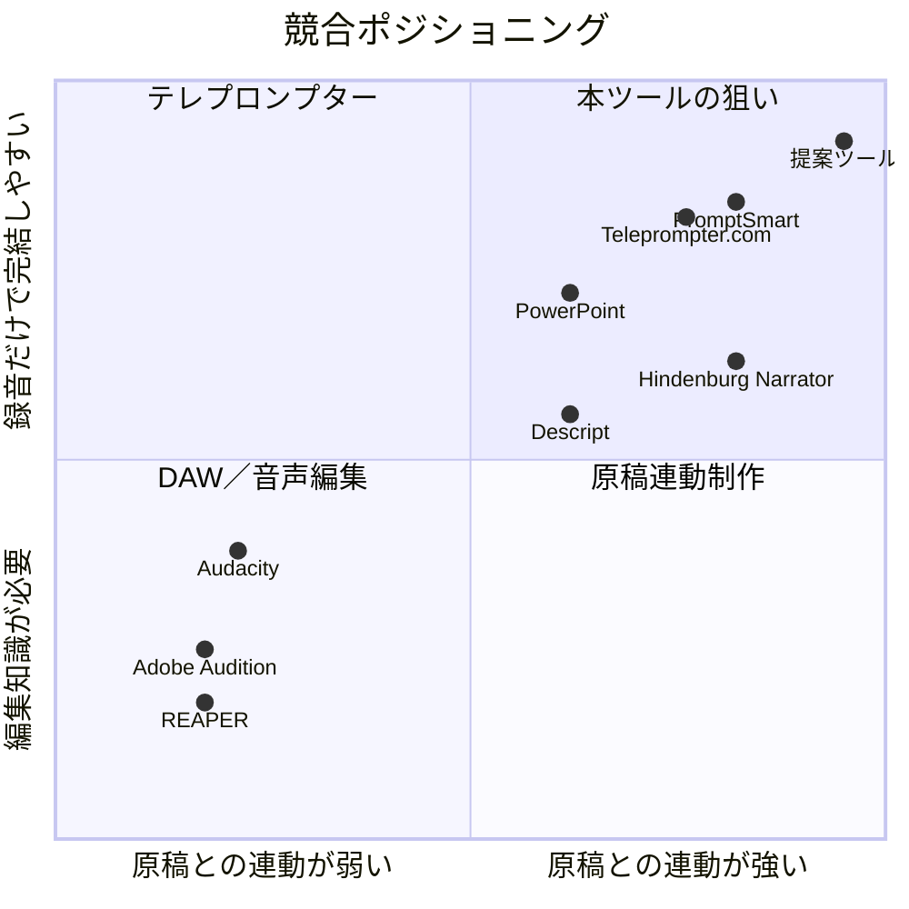
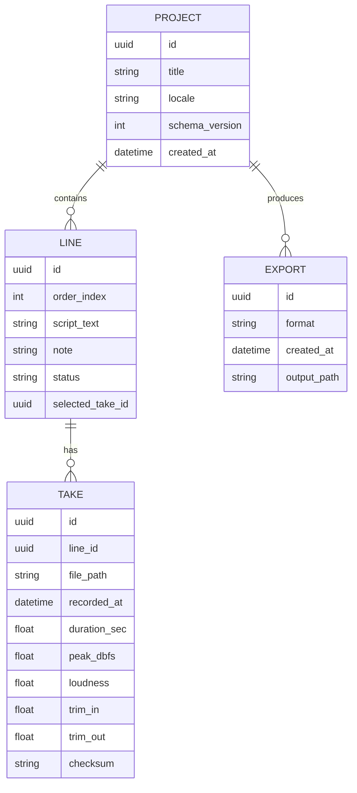
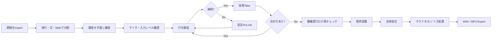
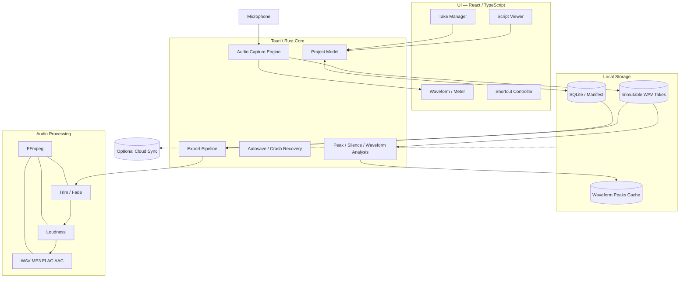
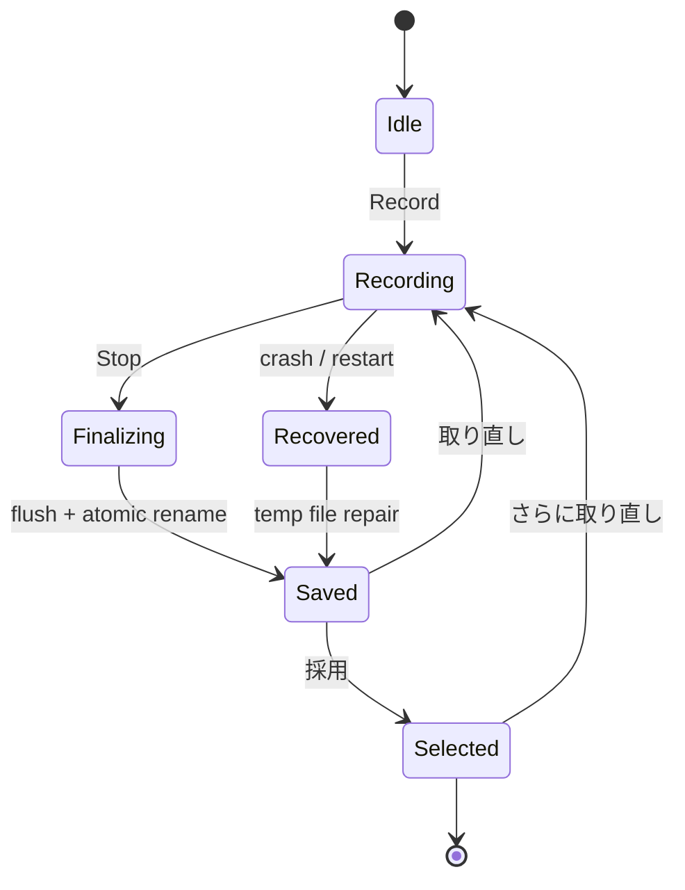
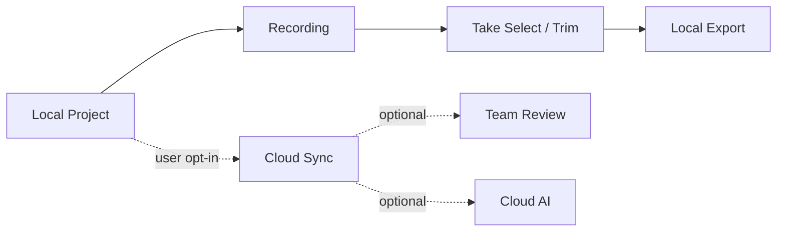
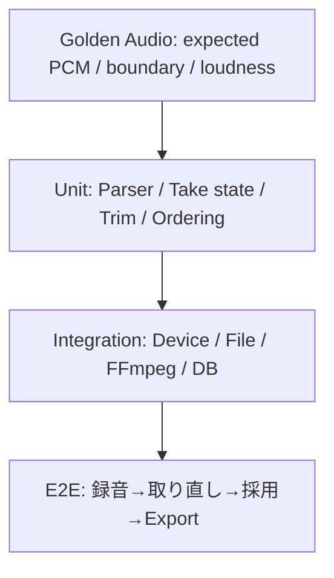
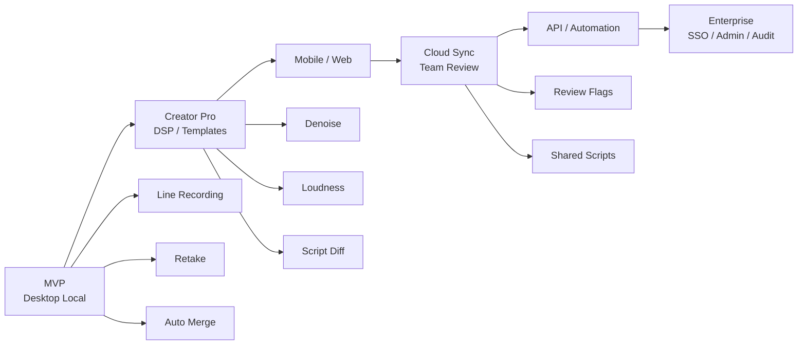
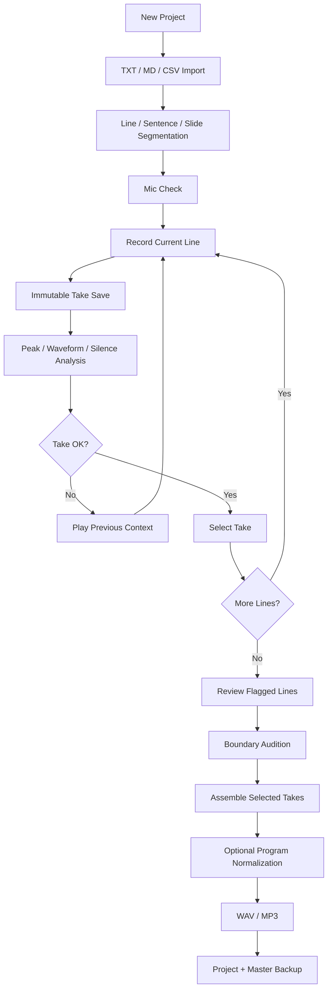

# 原稿を行単位で録音・取り直し・自動結合する「プレゼン／事前音声録音ツール」調査・設計レポート

## エグゼクティブサマリ

本ツールの中核価値は、一般的な音声編集ソフトの「タイムラインを編集する」発想ではなく、**「原稿の各行を録音単位として管理し、失敗した行だけを即座に取り直し、最後に採用テイクを順番通り自動組立てする」**ことにある。

競合を調べると、この発想に最も近いのは **Hindenburg Narrator** である。Narrator は原稿を画面に表示し、音声をテキスト構造に関連付け、pickup／Punch-and-Roll による取り直しを行える。 citeturn7view1turn4search17turn6search26 一方、Audacity、Adobe Audition、Pro Tools には Punch-and-Roll／Punch-in があり、PowerPoint には「現在のスライドだけ再録音」があるものの、いずれも「原稿行 → 複数テイク → 採用テイク → 全行自動結合」を中心モデルにはしていない。 citeturn0search12turn0search21turn12search4turn22search0 Teleprompter.com、PromptSmart、BIGVU、Canva は原稿を見ながら録画する用途には強いが、失敗箇所だけを音声単位で差し替えて組み立てる用途とは異なる。 citeturn10search9turn10search2turn10search0turn22search1

したがって、狙うべきポジションは「簡易DAW」でも「テレプロンプター」でもなく、**script-aware segmented recorder（原稿連動型セグメント録音ツール）**である。特に日本語の「。」「！」「？」、改行、スライド番号を認識して録音単位を作り、`未録音 → 録音済 → 要確認 → 採用` を可視化することが強い差別化になる。

MVPでは、高度なAI編集やクラウドを入れず、**Windows/macOS向けローカルファーストのデスクトップ版**を推奨する。Tauri 2 は Windows、macOS、Linux、Android、iOS を単一コードベースから対象にでき、CPAL はRustのクロスプラットフォーム低レベル音声I/Oを提供する。 citeturn17search7turn18search3 録音中は非圧縮PCM/WAVを保持し、FFmpegをエクスポート／無音処理／リサンプリング／ラウドネス処理に使う構成が実務上扱いやすい。FFmpegはフィルタ処理、トランスコード、連結に必要な機能を公式に提供している。 citeturn17search0turn17search4turn17search12

最大のUX上のポイントは「録音ボタン」そのものではない。**ミスをしてから正常な録音状態に復帰するまでを何操作で済ませられるか**である。理想フローは、

> ミスに気づく → 1キーで停止 → 取り直し → 採用 → 次の行

であり、タイムライン上で範囲選択、切断、削除、位置合わせをさせないことが重要である。

市場規模について「行単位録音ツール」という独立カテゴリの公的市場統計は存在せず、**正確なTAMは未指定**である。ただし隣接市場は十分大きい。国内クリエイターエコノミーは2024年に約2兆894億円、同調査の潜在市場は約14兆5,866億円と報告されている。 citeturn14search3turn14search11 また2026年の国内ポッドキャスト月間利用率は18.2%で、15～19歳は40.5%、20代は28.8%だった。 citeturn15search2turn15search5 日本の2025年平均就業者数は6,828万人であり、プレゼン・研修・営業・教育などの業務利用を考えると「クリエイターだけ」を対象にしない設計が重要である。 citeturn16search6

本レポートのMVP試算は **428～628人時**。便宜上の開発単価を1人時1万円と置けば **428万～628万円**、1.5万円なら **642万～942万円**。20%のリスクバッファを含めると、おおむね **514～754人時、約514万～1,130万円**のレンジとなる。これは市場価格の主張ではなく、本レポート内の設計を前提とした工数試算である。

推奨する初期商品像は次のとおりである。

| 項目 | MVP推奨 |
|---|---|
| 主対象 | プレゼン事前録音、研修・e-learningナレーション、YouTube/Podcast台本読み |
| プラットフォーム | Windows + macOS |
| 保存方針 | ローカルファースト、アカウント不要 |
| 原稿 | TXT / Markdown / CSV、貼り付け |
| 録音単位 | 改行・文・スライド単位を選択可能 |
| テイク管理 | 1行に複数テイク、非破壊で採用切替 |
| 取り直し | ワンキー再録音、前行末尾のpre-roll |
| 録音形式 | 内部48 kHz mono PCM/WAVを推奨 |
| 出力 | WAV / MP3、次段階でFLAC/AAC |
| 編集 | 無音トリム、境界フェード、音量統一 |
| クラウド | MVPでは不要 |
| AI | MVPでは不要。後からノイズ除去・文字照合を追加 |
| 価格仮説 | 無料版 + Pro年額6,000～9,600円程度を検証 |
| 最大の差別化 | 「タイムラインを編集しなくても、間違った行だけ取り直せる」 |

## 競合・市場・ユーザー

**必須項目 1 — 類似ソフト／サービスの網羅的リストと主要機能比較**

ここでの「網羅的」は、2026年9月7日時点で、①原稿を見ながら録音する、②音声を部分再録音する、③音声編集・結合する、④プレゼンを事前収録する、のいずれかで本ツールの代替になり得る主要製品を、デスクトップ・モバイル・Web・プラグイン／APIまで横断した実務的競合集合という意味である。

### 直接競合・原稿連動／プレゼン録音系

| 製品 | 主な機能・対応OS | 価格・ライセンス | 音声形式 | 編集 | 再録音のしやすさ | バッチ／最終結合 | API |
|---|---|---|---|---|---|---|---|
| **Hindenburg Narrator** | ナレーション、原稿表示、テキスト構造と音声を連動、Punch-and-Roll、pickup。Win/macOS系デスクトップ。 citeturn7view1turn4search17 | 商用。月額・年額・永久版の区分あり。ただし公式ショップ価格が調査時に正常取得できず**未指定**。 citeturn7view0 | audiobook向け出力。詳細一覧は未指定 | ◎ 原稿構造ベース | **◎ 最も近い** | ◎ audiobook全体を出力 | 公開APIは未指定 |
| **Microsoft PowerPoint** | スライドごとのナレーション、タイミング、インク、映像を録音。Win/mac等Office環境。 citeturn22search0turn22search8 | Microsoft 365 / Officeライセンス依存。単独価格は未指定 | スライド内に音声を保持。動画へ書出し可能。 citeturn22search20 | △ スライド単位 | **○ 現在のスライドを再録可能** citeturn22search0 | △ 動画化は可能、音声だけの行結合ではない | 録音機能専用APIは未指定 |
| **Teleprompter.com** | iOS/Android/macOS/Web、原稿スクロール、動画録画、音声追従等。 citeturn10search9turn10search16 | Free、Pro $19.99/月または年払い換算$7.50/月など。 citeturn10search1 | 詳細未指定 | △ 動画中心 | △ クリップ再録 | × 行単位結合なし | 未指定 |
| **PromptSmart+** | VoiceTrackで話速に追従するテレプロンプター。iOS/Android、StudioはWindows/macOSも対象。VoiceTrackは端末内処理でオフライン利用可能。 citeturn10search2turn10search10turn11search3 | Starter $9.99/月または$99.99/年。 citeturn11search3 | 録画中心、詳細未指定 | △ | △ | × | 未指定 |
| **BIGVU** | Web/iOS/Android系、テレプロンプター、字幕、動画編集、原稿作成。 citeturn10search0turn10search4turn10search18 | 無料枠あり。有料価格は今回の公式取得結果では**未指定** | 詳細未指定 | ○ 動画編集 | △ | △ 動画プロジェクトとして | 未指定 |
| **Canva Talking Presentations / Voice Recorder** | Web中心。プレゼンを表示しながらマイク・カメラ収録。オンライン音声録音・編集も提供。 citeturn22search1turn22search37 | Free/Pro等。今回の対象機能単独価格は未指定 | 詳細未指定 | ○ Canva上の編集 | △ | △ プレゼン／動画として | 録音機能APIは未指定 |
| **Riverside** | リモート音声・映像収録、編集、トラック書出し。 | プラン価格は今回の公式検索では**未指定** | MP3、HD WAV等。 citeturn3search2turn3search5 | ○ | △ 行単位ではない | ○ トラック／完成物出力 | **○ APIあり** citeturn3search2turn3search5 |

ここで特に重要なのは、PowerPointが既に「スライド単位の再録音」を利用者に教えている点である。Microsoftの公式手順では、同じスライドを再録すると以前のナレーション等を置き換えられる。つまり「全部撮り直さず、単位ごとに録り直す」というメンタルモデル自体は一般ユーザーにも説明可能である。 citeturn22search0 本ツールはその単位を**スライドから原稿行へ細分化する**と考えると説明しやすい。

### DAW・音声編集・後処理系

| 製品 | 主な機能・対応OS | 価格・ライセンス | 音声形式 | 編集 | 再録音のしやすさ | バッチ／結合 | API／拡張 |
|---|---|---|---|---|---|---|---|
| **Audacity** | Windows/macOS/Linux、録音・波形編集。無料。 citeturn1search8 | 無料、GPLv3。 citeturn1search0 | WAV等主要形式、Import/Export機能。 citeturn0search20 | ◎ | **○ Punch-and-Roll**。ミス前まで戻り、その位置から録音を継続できる。 citeturn0search12turn0search4 | △ 手動配置／書出し | 未指定 |
| **Adobe Audition** | Windows/macOS、Waveform/Multitrack、Punch-in、Timed Recording。 citeturn0search1 | US公式で$22.99/月（年間契約月払い）。 citeturn1search1 | WAV/MP3等多数 | ◎ | **○ Punch-and-Roll / Punch Again** citeturn0search21 | ○ mixdown | 未指定 |
| **REAPER** | Windows/macOS/Linux、フルDAW、軽量・スクリプト拡張。 citeturn5search3 | $60 discounted / $225 commercial、60日評価版。 citeturn5search0 | 多数 | ◎ | ○ punch/take運用 | **◎ regions/itemsを大量にrender可能** citeturn4search8 | **◎ ReaScript API** citeturn4search0 |
| **Pro Tools** | Windows/macOS、プロ向けDAW。Loop、playlist、精密punch。 citeturn12search8 | Artist $9.99/月、Studio $34.99/月、Ultimate $99/月。 citeturn12search8 | 多数 | ◎ | **◎ QuickPunch等** citeturn12search4 | ◎ bounce/mix | API詳細は未指定 |
| **DaVinci Resolve / Fairlight** | Windows/macOS/Linux、映像＋統合音声ポストプロダクション。 citeturn12search1 | Free / Studio $295。 citeturn12search5 | 多数 | ◎ | ○ タイムライン編集 | ◎ 全体render | API詳細は未指定 |
| **TwistedWave** | macOS、Windows、iPhone/iPad、Web。録音、編集、mastering、batch処理。 citeturn5search5 | Web系サブスク$9.99/月等。プラットフォームライセンスは別。 citeturn5search15turn5search13 | WAV、AIFF、MP3、M4A、AAC、FLAC、OGG等。 citeturn5search2 | ◎単一音声 | △ | ○ batch process/convert | 未指定 |
| **Ferrite Recording Studio** | iPhone/iPad。録音＋マルチトラック編集、Podcast/ジャーナリスト向け。 citeturn8search1turn8search7 | Free、Ferrite 3 Pro ¥5,000等。 citeturn9search0 | 詳細未指定 | ◎ | △ 手動 | ○ project mix | 未指定 |
| **Descript** | Mac/Windows/Web。文字起こしベース音声・動画編集、マルチトラック、Studio Sound。 citeturn2search1turn2search2 | Free、Hobbyistは年払い換算$16/月など。 citeturn2search0turn2search2 | MP3/WAV/AAC/FLAC。 citeturn2search2 | ◎ テキスト編集型 | ○ Regenerateで発話ミスを修正できるが、人間の再録音とは異なる。 citeturn2search3 | ○ | 一般公開録音APIは未指定 |
| **Auphonic** | 自動ポストプロダクション。Watch Folder、Zapier、CLI/API。 citeturn12search2 | 例：9時間/月 $13のプラン等。 citeturn12search18 | 複数形式 | ◎ 自動処理 | × 録音しない | **○ バッチ処理** | **◎ API/CLI** citeturn12search22 |
| **iZotope RX 12** | Windows/macOS、standalone＋DAW plug-in、音声repair/denoise。 citeturn12search3turn12search23 | Elements $99、Standard $399、Advanced $1,399。 citeturn12search15 | 多数 | ◎ 修復 | × 録音用途ではない | ○ バッチ系処理 | 公開録音APIは未指定 |
| **GarageBand** | Mac/iPhone/iPad、録音・mix・マルチトラック。 citeturn22search2turn22search6 | Apple提供。現行価格の詳細は未指定 | WAV/AIFF/AAC/MP3等のimport、音声ファイルとしてshare可能。 citeturn22search14turn22search22 | ◎ | △ | ○ mixdown | 未指定 |
| **Dolby On** | モバイル録音、音声・Podcast等の自動処理。 citeturn22search3turn22search7 | 無料。 citeturn22search7 | 詳細未指定 | ○ 自動enhance | △ | △ | 未指定 |

凡例は、**◎＝主要ワークフローとして強い、○＝実用可能、△＝可能だが主目的ではない、×＝対象外**である。

### 競争地図



位置は本調査による定性的評価で、外部市場データではない。

競合調査から最も重要な結論は、**DSP機能そのものでは差別化しにくい**ということである。Punch-in、denoise、normalization、multitrackは既存ツールが既に成熟している。Audacity、Audition、Pro Toolsは部分再録音、AuphonicやRXは後処理、Descriptはテキスト起点編集を既に提供している。 citeturn0search12turn0search21turn12search4turn12search2turn12search23turn2search2 差別化すべき対象は**編集技術ではなく、原稿と録音テイクを一対多で結び付けるプロジェクトモデルとUX**である。

**必須項目 2 — ユースケースとペルソナ**

| ペルソナ | 典型シーン | 現在の痛み | 求める成果 | 本ツールの重要機能 |
|---|---|---|---|---|
| 企業の営業・企画担当 | 3～15分の提案プレゼンを事前録音 | 9分目の言い間違いで最初から撮り直す | 短時間で自然な完成音声 | スライド／行単位、1キー再録 |
| 講師・e-learning制作者 | 数十～数百行の教材ナレーション | DAW編集に時間がかかる | 原稿どおりの高品質音声 | 原稿リンク、発音メモ、テイク管理 |
| Podcastホスト | intro、スポンサー読み、台本回 | 読み間違い後の切り貼りが面倒 | テンポを維持した完成素材 | pre-roll、境界試聴、自動結合 |
| YouTube／動画制作者 | 後付けvoice-over | 映像編集ソフト内で何度も録り直す | WAVを1本出してNLEに投入 | 48 kHz WAV、タイムスタンプ |
| ナレーター／声優 | 短文、広告、教材、ゲーム台詞 | takeファイルが大量になり採用管理が煩雑 | 行ID付きで確実に採用takeを管理 | 複数take、★採用、ファイル命名 |
| 学生・研究者 | 発表練習、学会発表、語学発表 | 通し練習では苦手箇所が特定しづらい | つまずく文を反復 | 練習モード、行別所要時間 |
| アクセシビリティ／社内広報担当 | 読み上げ音声作成 | 音声編集専門家を置けない | 非専門家でも修正可能 | キーボード操作、明快な状態表示 |

ポッドキャストは2026年国内調査で月間利用率18.2%に達し、とりわけ若年層で高い利用率が報告されているため、Podcastそのものを主市場としなくても、台本付き音声制作は有力な隣接用途である。 citeturn15search2turn15search5

**必須項目 6 — 市場分析**

「line-by-line recorder」単独の市場統計は**未指定**であり、既存の市場調査をそのままTAMと呼ぶのは不適切である。そのため、トップダウン市場とボトムアップ利用者仮説を分ける。

| 市場指標 | 現状 | 本製品との関係 |
|---|---:|---|
| 国内クリエイターエコノミー | 2024年 約2兆894億円 | 広すぎるためTAMではなく隣接市場の成長性指標。 citeturn14search3turn14search11 |
| 同調査の潜在市場 | 約14兆5,866億円 | 同上。直接売上規模として利用しない。 citeturn14search3 |
| 国内Podcast利用率 | 18.2% | 音声コンテンツ利用／制作人口の周辺指標。 citeturn15search2 |
| 15～19歳Podcast利用率 | 40.5% | 教育／若年クリエイターへの将来展開を示唆。 citeturn15search5 |
| 日本の就業者数 | 6,828万人（2025年平均） | 企業プレゼン・研修市場の母集団 proxy。 citeturn16search6 |

ボトムアップの仮説として、就業者6,828万人のうち **1～3%が年数回以上この種の録音を必要とする**と仮定すると、潜在的反復利用者は約68万～205万人になる。これは外部統計ではなく本レポートの仮定である。そのうち3～8%が年間7,200円のProを購入すると仮定した単純シナリオでは、約2.0万～16.4万人の有料利用者、年間約1.47億～11.8億円となる。この数値は**市場予測ではなく、価格感度・獲得率を検証するためのシナリオ**として扱うべきである。

### 競争優位性

| 優位性 | なぜ重要か |
|---|---|
| **原稿行＝録音オブジェクト** | DAWの「時間軸」ではなく、利用者が既に理解している「原稿」を編集単位にできる |
| **非破壊take管理** | 取り直しても以前の良いtakeを失わない |
| **ワンキーretake** | 編集スキルを必要としない |
| **自動assembly** | 48個の行を手動で並べる作業を消す |
| **日本語原稿最適化** | 改行、「。」「！？」、スライド見出し、ルビ／発音メモに対応できる |
| **ローカルファースト** | 未発表プレゼン、顧客情報、研究原稿をクラウド送信せず扱える |
| **練習＋本番録音を同一UIで提供** | テレプロンプター、DAW、プレゼンソフトの隙間を埋める |

Hindenburg Narratorが原稿と音声構造を結び付け、pickupやPunch-and-Rollを提供しているため、「原稿連動」だけでは十分な参入障壁にならない。 citeturn7view1turn6search26 日本語プレゼン、軽量性、1行take管理、ローカルファースト、価格の低さまで組み合わせる必要がある。

### 推奨価格モデル

競合価格では、PromptSmart Starterが$9.99/月、Teleprompter.com Proが月払い$19.99、DescriptのHobbyistが年払い換算$16/月からであり、本製品は機能を絞ればこれらより安いポジションを取れる。 citeturn11search3turn10search1turn2search2

| プラン案 | 仮価格 | 内容 |
|---|---:|---|
| Free | ¥0 | ローカル録音、基本take管理、WAV出力、3～5プロジェクト |
| Pro | ¥800～1,200/月 または ¥6,000～9,600/年 | 無制限プロジェクト、MP3/FLAC、ノイズ処理、ラウドネス、テンプレート |
| Pro Lifetime | ¥8,000～12,000買切り | ローカル機能中心。クラウド機能は別料金 |
| Team | ¥1,500～2,500/席/月 | クラウド同期、共有原稿、レビュー、管理 |
| API/Automation | 従量制 | 自動assembly、normalization、企業ワークフロー |

特にこの製品では、**音声ウォーターマークを無料版制限に使わない**方が良い。成果物を壊す制限より、プロジェクト数、高度処理、クラウド同期などを課金境界にする方が製品価値と整合する。

## プロダクト要件とUX

**必須項目 3 — 必須・推奨機能一覧**

### 機能優先度

| 機能 | 優先度 | 推奨仕様 |
|---|---|---|
| **UI/UX** | **MUST** | 1画面で原稿・録音・take選択が完結。DAW型タイムラインを主UIにしない |
| **行単位表示** | **MUST** | 現在行を大表示、前後1行を薄く表示。改行／文／段落／スライド単位切替 |
| **行ごとの録音管理** | **MUST** | 1行にtake A/B/C…を保持。採用takeを1つ選択 |
| **再録音** | **MUST** | 1操作で現行行を再録。以前のtakeは保持 |
| **メタデータ** | **MUST** | line ID、take ID、原稿、録音日時、duration、device、sample rate、採用状態、メモ |
| **タイムスタンプ** | **MUST** | 原稿内位置、完成音声上の開始時刻をexport時に生成 |
| **波形表示** | **MUST** | 現行takeと前後境界を簡潔に表示 |
| **入力レベルメーター** | **MUST** | clipping警告、マイク未入力検知 |
| **ショートカット** | **MUST** | 録音／停止、再録、採用、前後移動をキーボードのみで実行 |
| **自動保存** | **MUST** | 録音停止ごとに即保存。録音済みファイルを上書きしない |
| **バックアップ／復旧** | **MUST** | crash後に録音済みtakeを再発見して復旧 |
| **無音トリム** | **MUST** | 非破壊trim。自動結果を手動調整可能 |
| **結合** | **MUST** | 採用takeを原稿順に自動assembly |
| **エクスポート形式** | **MUST** | WAV、MP3。FLAC/AACは次段階 |
| **境界フェード** | **MUST** | クリック防止用の極短fade、調整可能 |
| **音量正規化** | **SHOULD** | 完成プログラム全体に適用 |
| **ノイズ除去** | **SHOULD** | 非破壊／ON-OFF比較、過処理警告 |
| **原稿変更追跡** | **SHOULD** | 録音後にテキストを変えると「原稿変更あり」を表示 |
| **発音・演技メモ** | **SHOULD** | 「アクセント」「強調」「間」等をline metadataに保持 |
| **境界A/B試聴** | **SHOULD** | 前行末尾＋現行＋次行冒頭だけを即再生 |
| **クラウド同期** | LATER | opt-in。MVPは不要 |
| **複数トラック** | LATER | BGM、効果音程度から追加 |
| **共同レビュー** | LATER | reviewerが「要再録」をline単位で付与 |
| **AI原稿照合** | LATER | 読み飛ばし・言い換え検出 |
| **PowerPoint連携** | LATER | slide notes / slide番号を原稿単位としてimport |

### 推奨データモデル

最大の設計判断は、「音声ファイルを行番号で上書きする」のではなく、**Line と Take を分離する**ことである。



たとえば行12を5回取り直しても、

`line-12 → take-A, take-B, take-C, take-D, take-E`

と保持し、`selected_take_id = take-D`だけを変える。この方式ならUndoがほぼ不要になり、事故による良いtakeの消失も避けられる。

### 推奨ワイヤーフレーム

```text
┌─────────────────────────────────────────────────────────────┐
│ Project: 新製品プレゼン          12 / 48       🎙 USB Mic   │
├─────────────────────────────────────────────────────────────┤
│ 前:   この課題を解決するために、三つの機能を用意しました。 │
│                                                             │
│       「まず第一に、録音を一行単位で管理します。」         │
│                                                             │
│ 次:   間違えた場合には、その行だけを録り直せます。         │
├─────────────────────────────────────────────────────────────┤
│      ▁▂▃▆█▅▃▂▁  ▁▃▅▇▅▂▁      00:06.82     Peak -7.1 dBFS │
│                                                             │
│ Take A  00:07.41        Take B ★ 00:06.82       Take C ... │
├─────────────────────────────────────────────────────────────┤
│ [Space ●録音/停止] [R ↻取り直し] [Enter ✓採用] [→ 次へ]   │
│                                                             │
│ 状態: ✓録音済み     発音メモ: 「第一」を強調               │
└─────────────────────────────────────────────────────────────┘
```

「録音中」は赤色だけに依存せず、`● 録音中`という文字、タイマー、枠、任意の通知音／振動を併用する。

**必須項目 7 — UX改善提案とアクセシビリティ**

WCAG 2.2ではLevel AAのポインタターゲット最小サイズとして24×24 CSS pxが規定され、通常テキストには4.5:1以上のコントラストが求められる。フォーカス表示も明瞭であることが重要である。 citeturn17search1turn17search17turn17search9 モバイルへのWCAG 2.2適用についてもW3Cがガイダンスを公開している。 citeturn17search33

| 課題 | UX改善 |
|---|---|
| 読んでいる場所を見失う | 現在行を中央に固定、前後行は低強調 |
| 取り直し時にリズムを失う | 前行末尾を1～3秒pre-rollしてから録音開始 |
| どのtakeが良かったか分からない | A/B/Cカード＋★採用＋短いコメント |
| 編集後のつながりが不自然 | 「境界だけ試聴」ボタン |
| 原稿が修正された | 録音済み行を消さず「原稿変更あり」と警告 |
| マウス操作が負担 | すべての主要操作にショートカット |
| 視覚障害／低視力 | 読み上げラベル、大文字サイズ、高コントラスト |
| 色覚差 | 緑／赤だけでなく✓、!、●、文字ラベル併用 |
| 運動障害 | 大型ボタン、キー変更、後期版でフットペダル対応 |
| 認知負荷 | 高度編集を「詳細」へ隠し、通常画面は4操作程度 |
| 録音への不安 | clipping／無音／デバイス切断を録音直後に自動判定 |

特に有効なのが**「取り直しは置換ではなく新take追加」**という表示である。「取り直すと前の録音が消える」という恐怖がなくなる。

### 原稿編集時の重要UX

原稿録音後に文章が変更されるケースも設計しておくべきである。

たとえば、

> 旧：「本サービスは三つの特徴があります。」  
> 新：「本サービスには四つの特徴があります。」

となった際、録音ファイルを削除せず、

`⚠ 原稿変更あり — 現在の録音は旧原稿です`

とする。LCS／diffで変更行を対応付け、未変更行のtakeを維持できると、長い原稿ほど価値が高い。

**必須項目 11 — プレゼン準備支援**

### 原稿テンプレート

| Slide | Line ID | 原稿 | 話し方・意図 | 強調 | 間 | 目標秒 | 発音メモ | 状態 |
|---:|---|---|---|---|---|---:|---|---|
| 1 | S01-L01 | 本日は新しい録音方法をご紹介します。 | ゆっくり開始 | 新しい | 文末0.3秒 | 5 | — | 未録音 |
| 1 | S01-L02 | 間違えた箇所だけを録り直せる仕組みです。 | 利点を明確に | だけ | 0.4秒 | 6 | 録り直せる | 未録音 |
| 2 | S02-L01 | 従来は、最初から録音し直す必要がありました。 | 問題提起 | 最初から | 0.5秒 | 6 | — | 未録音 |

TXTだけでなく、将来的には以下のようなMarkdownをそのまま読めると扱いやすい。

```markdown
# Slide 1 — はじめに

本日は、新しい録音方法をご紹介します。
間違えた箇所だけを録り直せる仕組みです。

> note: 「だけ」を強調

# Slide 2 — 課題

従来は、最初から録音し直す必要がありました。
```

### 練習用シナリオ

| シナリオ | 練習目的 | ツール側の支援 |
|---|---|---|
| 3分ピッチ | 簡潔さ・テンポ | 行ごとの秒数、全体予定時間 |
| 10分社内プレゼン | スライド切替との整合 | slide marker、区間時間 |
| 20分ウェビナー | 長時間での安定性 | chapter管理、休憩ポイント |
| 60秒広告読み | 語尾とテンポ | take比較、目標時間 |
| 技術解説 | 専門用語 | 発音メモ、要再録フラグ |
| e-learning | 多数の短文 | CSV import、連続録音モード |

### 録音チェックリスト

| タイミング | チェック |
|---|---|
| 録音前 | 正しいマイクを選択、空き容量確認、通知停止、試し録り、入力レベル確認 |
| 録音前 | 10秒程度の室内音を確認し、空調・PCファン・反響をチェック |
| 録音中 | マイクとの距離を大きく変えない、ミス時はその場でretake |
| 録音中 | clipping／無音警告が出た行を先に直す |
| 全行終了 | 「要確認」行を0件にする |
| 結合後 | 行境界、音量差、不自然な無音、ノイズ処理を確認 |
| 最終 | ヘッドホンと通常スピーカーの双方で一度確認 |
| 保存 | projectファイル＋完成WAVを別媒体／同期先へバックアップ |

### 推奨プレゼン練習ワークフロー



この順序では「編集作業」が独立工程として存在しない。それ自体が製品価値である。

## 技術設計と実装

**必須項目 4 — 技術実装案**

### 推奨アーキテクチャ

デスクトップMVPは **Tauri 2 + React/TypeScript + Rust audio core + SQLite/JSON + FFmpeg** を第一候補とする。

Tauri 2は公式にLinux、macOS、Windows、Android、iOSを対象としており、WebフロントエンドとRust/native logicを組み合わせられる。 citeturn17search7turn17search15 ただしTauri自身も、モバイルについてすべてのデスクトップ機能・pluginが同等に利用できるわけではないことを説明しているため、「Tauriだから即座に5 OS同品質」とは考えない方がよい。 citeturn17search35



### 技術スタック候補比較

| 領域 | 推奨 | 代替 | 判断 |
|---|---|---|---|
| Desktop shell | **Tauri 2** | Electron | Tauriを第一候補。クロスプラットフォームとnative/Rust統合。 citeturn17search7 |
| UI | React + TypeScript | Vue/Svelte | チーム経験優先。音声処理はUIから分離 |
| Desktop audio I/O | **CPAL** | OS native API | Rustで統一しやすい。CPALはクロスプラットフォーム低レベル音声I/OでApache-2.0。 citeturn18search3turn18search15 |
| Codec/DSP | **FFmpeg** | 個別codec library | concat、filter、transcodeを一括処理可能。 citeturn17search0turn17search4 |
| Metadata | SQLite + versioned JSON | JSONのみ | DBは状態管理、JSONはproject portability |
| Web recording | MediaRecorder + Web Audio | custom WASM capture | W3C MediaStream Recordingが標準的録音APIを定義。 citeturn18search0turn18search24 |
| Web real-time DSP | AudioWorklet | main-thread processing | Web Audioはaudio routing/processing APIを標準化。 citeturn18search32 |
| iOS | AVAudioEngine / AVAudioNode tap | Tauri plugin wrapper | Appleのtapはnode出力をrecord/monitor/observeできる。 citeturn19search27turn18search13 |
| Android | Oboe / AAudio | AudioRecord | AAudioは低遅延高性能用途、OboeはAPIレベル差を吸収しautomatic latency tuningを提供。 citeturn19search0turn19search2 |

### 録音方式

内部録音は、最初からMP3にせず **PCM/WAV** を推奨する。これは本レポートの設計判断であり、次の利点を狙う。

`Mic → PCM buffer → temporary WAV → flush/fsync → atomic rename → analysis`

録音中に圧縮codec、ノイズ除去、ラウドネス解析を同時に行わず、リアルタイムスレッドの仕事を最小化する。録音停止後、バックグラウンドでwaveform、peak、silence等を解析する。

推奨内部設定は以下である。

| 項目 | デフォルト案 |
|---|---|
| sample rate | 48 kHz |
| channel | mono |
| working format | PCM 24-bit または float32内部処理 |
| take保存 | WAV |
| UI meter refresh | audio callbackとは別スレッド |
| ファイル名 | UUID主体。人間向け番号はmetadataで保持 |

48 kHzは本製品のプレゼン／動画用途向け**製品デフォルト案**であり、入力デバイスのnative sample rateが異なる場合は無理にcapture callback内で変換せず、後段で統一する設計が安全である。

### take保存アルゴリズム



`take-B`を録ったからといって`take-A`を削除しない。Immutable take方式にすることで、「録り直したら前の方が良かった」という日常的ケースを安全に処理できる。

### 結合アルゴリズム

単純にMP3ファイルをバイト連結するのではなく、一度共通PCM条件へそろえてからassemblyする。

```text
採用Take一覧取得
    ↓
各Takeを共通sample rate/channelへdecode/resample
    ↓
非破壊trim-in / trim-outを適用
    ↓
境界に数msのfade-to-zero / fade-in
    ↓
行間pauseを挿入
    ↓
全行をPCMでconcat
    ↓
完成音声全体のloudnessを解析・normalize
    ↓
WAV / MP3 / FLAC / AACへencode
```

FFmpegはaudio crossfade/filteringを提供し、concat demuxerでは連続ファイルとして扱う際のtimestamp調整も行う。 citeturn17search0turn17search12 ただし本製品では、発話末尾と次の発話冒頭を重ねるcrossfadeをデフォルトにするより、**両端をごく短くゼロへfadeして、意味のあるpauseを残す**方が自然なケースが多い。

行間pauseはユーザー設定可能にし、たとえば初期プリセットとして、

| 原稿境界 | 初期pause案 |
|---|---:|
| `、`相当 | 120 ms |
| `。！？` | 250 ms |
| 段落 | 450 ms |
| スライド切替 | 600 ms |

などをA/Bテストする。これは言語学的標準値ではなく、**UX検証用の初期値**である。

また、無音トリムは「無音を全部消す」のではなく、呼吸や話の間を壊さない必要がある。ユーザーが「境界だけ試聴」して簡単に戻せる非破壊処理にする。

### ラウドネス処理

ITU-R BS.1770-5は現在有効なprogramme loudness／true-peak測定アルゴリズムを規定している。 citeturn20search1turn20search4 FFmpegにはloudness関連を含むaudio filtersが実装されているため、MVP後半ではこれを利用して「Presentation」「Podcast」「Broadcast」等の出力プリセットを用意できる。 citeturn17search0

重要なのは、**各行を別々に強く正規化してから結合しない**ことである。そうすると行ごとにambient noiseや声の質が上下する可能性がある。基本は全体をassemblyした後にprogramme-levelで測定・補正し、明らかにレベルが違うtakeだけ事前gain matchingする。

### Web版

W3C MediaStream Recording仕様は`MediaRecorder`によるMediaStream録音を定義し、timesliceが大きすぎるとUA側のbufferingによるresource pressureにつながり得ることも記載している。 citeturn18search0 Web版を作る場合は、

`getUserMedia → MediaStream → MediaRecorder / AudioWorklet → IndexedDB/File System → Worker/WASM → export`

という構成が現実的である。

ただしWeb版はブラウザごとのcodec、microphone permission、file system、backgroundingの差を受けるため、**録音の確実性を最優先する最初の製品としてはデスクトップ版を優先**する。

### iOS／Android版

iOSではAVAudioEngineとaudio tap、AndroidではAAudio／Oboeを利用するnative layerが候補になる。Appleの`installTap`はnodeの出力を録音・監視する目的で提供される。 citeturn19search27 AndroidのAAudioは高性能・低遅延audio向けのC APIであり、OboeはAAudio/OpenSL ES等を抽象化し、自動latency tuningなどを提供する。 citeturn19search0turn19search2

モバイルでは録音処理よりも、電話着信、Bluetooth経路切替、画面ロック、バックグラウンド移行、マイク権限取消しなどの状態遷移がQAコストを増やす。したがってMVPとは分離する。

### オフライン対応

基本操作は完全オフラインにする。



録音、原稿、take管理、WAV生成をネットワーク障害に依存させない。Teleprompter／クラウド編集競合に対して、これは特に機密プレゼンや研究・社内研修用途で差別化要素になる。

### 遅延対策

Android側ではGoogleがAAudioを低遅延用途向けと位置付け、Oboeもlow-latency stream取得を主要目的としている。 citeturn19search0turn19search11 本製品ではリアルタイム音声effectよりも録音確実性が重要なので、以下を採る。

| 対策 | 理由 |
|---|---|
| streamを録音開始前にopen | ボタン押下後の初期化待ちを減らす |
| callback内でfile encodingしない | deadline missを避ける |
| lock-free/ring buffer | captureとdisk I/Oを分離 |
| waveform描画を別thread | UI描画停止が録音に影響しない |
| PCM capture | codec起動遅延を切り離す |
| pre-rollはoutput側だけ | 取り直しのテンポを保つ |
| input monitoringはoptional | Bluetooth等で遅延が大きい環境を避ける |
| device hot-swap検知 | USB mic抜け等でsilent recordingしない |

## セキュリティと品質

**必須項目 8 — セキュリティ・プライバシー**

本製品では音声が単なる「ファイル」ではなく、場合によっては個人情報になる点を最初から設計に織り込む必要がある。

個人情報保護委員会は、通話録音がそれ単独で個人を識別できない場合は基本的に個人情報に該当しない一方、他情報との容易な照合により個人を識別できる場合は個人情報になり得るとしている。また、音声から特徴量を抽出して本人認証可能なデータに変換した場合、そのデータは個人識別符号に該当すると説明している。 citeturn21search0turn21search7 したがって、原稿、氏名、プロジェクト名、音声をまとめて扱う本製品では、実務上は機微なユーザーデータとして扱う設計が妥当である。

### ローカル保存とクラウドの比較

| 方式 | 利点 | リスク | 推奨 |
|---|---|---|---|
| ローカルのみ | 低漏えい面積、オフライン、アカウント不要 | PC紛失・故障 | **MVPデフォルト** |
| 自動クラウド | backup、複数端末 | 機密原稿が意図せずuploadされる | 非推奨 |
| opt-in cloud | 利便性とprivacyの両立 | consent/UI設計が必要 | Phase 2 |
| end-to-end encrypted sync | 高いprivacy | collaboration、server DSPが難しい | Pro privacy機能候補 |

Dolby Onも利用規約上、ユーザーコンテンツを端末上にローカル保存できる設計を採用している。 citeturn22search23 音声ツールにとってlocal-firstは特殊な概念ではない。

### 保存設計

```text
Project Folder
├── project.json              ← portable metadata
├── project.db                ← operational state
├── takes/
│   ├── {uuid}.wav            ← immutable
│   └── ...
├── peaks/
│   └── {uuid}.bin
└── exports/
    └── presentation.wav
```

プロジェクトフォルダを丸ごとコピーすればバックアップできる設計が望ましい。

### 暗号化

クラウドを導入する場合は、独自暗号を設計せず、KMS／OS key storeを用い、実績のあるauthenticated encryptionを利用する。NIST SP 800-38DはGCMをauthenticated encryption with associated dataとして規定している。なお、NISTは2026年にもSP 800-38Dの改訂作業を継続している。 citeturn20search5turn20search11

推奨構成は、

`TLS in transit + managed encryption at rest + per-project/tenant key separation + OS keychain/KMS`

である。個人情報保護委員会も、個人データをインターネット等で送信する際の暗号化としてSSL/TLS等を技術的安全管理措置の例に挙げている。 citeturn21search22

### 同意フロー

クラウド／AI機能を導入する場合は、同意を一括にしない。

| タイミング | 表示 |
|---|---|
| 初回録音 | 「マイクを使用して、この端末に音声を保存します」 |
| Cloud Sync初回 | 「原稿と音声がサーバーへアップロードされます」 |
| AI denoise/transcription初回 | 「音声が○○処理環境へ送信される」 |
| Share | 誰が、いつまで閲覧できるか |
| Delete | localのみ／cloud含む、削除対象を明示 |

Telemetryには音声、原稿本文、ファイル名をデフォルトで含めない。クラッシュレポートにもproject pathやscript textが混入しないようsanitizeする。

**必須項目 9 — テスト計画と品質基準**

### 音質・データ品質基準

ITU-R BS.1770-5をラウドネス／true-peak measurementの基礎に使える。 citeturn20search1 EBUもloudness test materialを公開しており、loudness implementationの検証材料として利用できる。 citeturn20search6

以下は外部標準ではなく、本製品のQA gateとして推奨する。

| 項目 | MVP品質基準案 |
|---|---|
| dropout | 正常環境の10分連続録音でsample dropout 0 |
| clipping | clipping検知率100%を目標、ユーザーへ即警告 |
| recording loss | 正常にStopしたtakeのデータ消失0件 |
| crash recovery | 強制終了後、完了take 100%復旧 |
| line order | 1000行テストで順序誤り0 |
| duplicate/skip | assemblyで採用takeの重複・欠落0 |
| join click | 自動試験＋聴取試験で可聴clickなし |
| duration | metadataとrender durationの整合 |
| loudness | preset targetに対し製品許容範囲内 |
| peak | export presetの上限を超えない |
| deterministic export | 同一入力・同一設定で同一PCM結果 |
| Unicode | 日本語、絵文字、全角記号、長音等でline ID破損なし |

### テストピラミッド



### 必須failure injection

音声ソフトでは通常操作よりfailure pathが重要である。

| 事故 | 期待動作 |
|---|---|
| 録音中にアプリkill | `.part`を次回起動時に検出、可能な範囲でrepair |
| USB micを抜く | 即停止＋明確なdevice error |
| disk full | 破損takeを採用扱いにしない |
| sleep移行 | recording状態を正しく復旧／警告 |
| export中kill | 元takeに一切影響なし |
| 原稿を大量編集 | 既存takeを勝手に削除しない |
| FFmpeg処理失敗 | raw WAVを保持 |
| DB破損 | project.json＋take directoryからrepair可能 |

### UIテスト

W3CのWCAG 2.2基準に沿い、キーボードのみでRecord、Stop、Retake、Select、Next、Exportまで到達できることをacceptance testに含める。文字コントラスト4.5:1、最小pointer target 24×24 CSS pxも自動／手動チェック対象にする。 citeturn17search1turn17search17

### ユーザーテスト

初期テストは音声編集経験者だけでなく、**Audacityを使えない／使いたくない人**を含めるべきである。

| 指標 | 目標案 |
|---|---:|
| 初見で1行目を録音できる率 | 95%以上 |
| ミス認識→retake開始 | median 5秒未満 |
| 誤takeを削除してしまう事故 | 0 |
| 10行録音完了まで質問なし | 80%以上 |
| 完成音声を自力export | 90%以上 |
| 「タイムライン編集が必要だと思った」 | 10%未満 |
| crash後に作業継続可能 | 100% |
| SUS等の総合UX評価 | 80以上を内部目標 |

ユーザーテストでは「操作できたか」だけでなく、「ミスを恐れず喋れるか」を観察する。録音ソフトの心理的負荷低減がこの製品の本質だからである。

## 開発計画・コスト・ロードマップ

**必須項目 5 — 開発工数と概算コスト**

以下は、Windows/macOSを対象としたデスクトップMVP、Tauri/Rustを採用し、クラウド、AI、multitrack BGMを除いた場合の本レポート試算である。

| 開発領域 | 人時 |
|---|---:|
| Architecture／project schema | 24～36 |
| 原稿import／parser | 28～44 |
| audio device／capture engine | 60～88 |
| line／take管理 | 48～72 |
| playback／waveform | 32～48 |
| retake／pre-roll | 32～48 |
| trim／assembly／export | 48～72 |
| metadata／autosave／recovery | 28～44 |
| shortcuts／accessibility | 24～36 |
| QA／device test／packaging | 56～80 |
| **基本合計** | **380～568** |

最終チケット分解では細かな統合作業を含めて **428～628人時**程度を安全側のMVP見積りとする。

### コスト換算

市場相場ではなく、単純な試算単価として、

| 想定単価 | 428人時 | 628人時 |
|---|---:|---:|
| ¥10,000 / 人時 | ¥4.28M | ¥6.28M |
| ¥15,000 / 人時 | ¥6.42M | ¥9.42M |

20%の仕様・device・QAリスクバッファを入れると514～754人時程度となり、

| 想定単価 | 20%バッファ込み概算 |
|---|---:|
| ¥10,000 / 人時 | 約¥5.14M～¥7.54M |
| ¥15,000 / 人時 | 約¥7.70M～¥11.30M |

となる。

### プラットフォーム別追加工数

| 追加対象 | 増分工数案 | 主な理由 |
|---|---:|---|
| Linux正式対応 | +40～80h | distro/audio backend/package QA |
| Web/PWA | +180～280h | MediaRecorder差、file permission、browser QA |
| iOS | +180～300h | AVAudioEngine integration、route/interruption |
| Android | +200～340h | Oboe/AAudio、device fragmentation |
| Cloud Sync | +160～240h | auth、storage、conflict、privacy |
| Team Review | +120～200h | permissions、comments、revision |
| AI denoise/transcription | +80～160h | model/API integration、UX、privacy |
| BGM／multitrack | +100～180h | timeline/mixer complexity |

AndroidではAAudio／Oboe、iOSではAVAudioEngineを利用できるものの、それぞれ固有のaudio lifecycleがあるため、単純な「UI移植」と見積もるべきではない。 citeturn19search0turn19search2turn19search27

**必須項目 10 — ロードマップとリリースプラン**

### MVP

目標は「1行ずつ録音して、間違えた行だけ取り直し、完成音声1本を出せる」ことだけである。

```text
原稿import
→ 行表示
→ 録音
→ 複数take
→ retake
→ 採用
→ trim
→ 全行assembly
→ WAV/MP3 export
```

**MVPに入れないもの**はクラウド、アカウント、生成AI、全文文字起こし、共同編集、高度multitrack、動画録画である。範囲を絞ることで「録音を失わない」「retakeが速い」というコア品質に集中する。

### 機能拡張

MVPの次に、noise reduction、programme loudness normalization、発音メモ、原稿変更diff、PowerPoint note import、FLAC/AAC、境界の自動pause、BGM 1track程度を追加する。

Auphonic、RX、Descriptが高度後処理領域では既に強いため、 citeturn12search2turn12search23turn2search2 独自denoiseアルゴリズム開発より、**原稿認識・take workflow改善に研究開発費を置く**方が競争力につながりやすい。

### スケール

その後に、

`Web → iOS/Android → Cloud Sync → Team Review → API → Enterprise`

と展開する。



### Release gate

| 段階 | 対象 | Exit条件 |
|---|---|---|
| Prototype | 開発・デザイン | 10行録音→3回retake→exportが成立 |
| Alpha | 10～20人程度 | data loss 0、主要micで安定 |
| Closed Beta | 50～100人程度 | crash-free session 99%以上を内部目標 |
| Public Beta | 一般 | migration、updater、telemetry/privacy整備 |
| GA | 有料販売 | P0/P1既知不具合0、installer/signing、backup手順確立 |
| Scale | Team/Enterprise | access control、audit、support運用 |

Tauriには公式updater pluginがあり、Windows/Linux/macOS/Android/iOS向けのサポート表が公開されているため、将来的なapp update基盤にも利用候補となる。 citeturn17search39

## 参考資料とMVPチケット

**必須項目 12 — 参考資料と優先的に参照するソース**

本調査では、技術仕様について公式ドキュメント／標準／OSS本家を優先し、競合機能・価格は可能な限り製品公式サイトを使用した。「原稿1行＝録音単位」という特定UXそのものを直接扱う査読学術研究については、今回の調査で実装判断に使える有力な直接対応論文は**未指定**である。そのため、UX仮説はHindenburg、Audacity、PowerPoint等の実装例とユーザーテストで検証するのが妥当である。

### 優先参照資料

| 分野 | 資料 | 用途 |
|---|---|---|
| 最重要競合 | Hindenburg Narrator公式 | script-linked recording / pickups / Punch-and-Roll。 citeturn7view1turn4search17 |
| オープンソース競合 | Audacity公式／Manual | Punch-and-Roll、record/export。 citeturn0search4turn0search12turn1search8 |
| DAW | Adobe Audition公式 | punch-in、pre-roll。 citeturn0search1turn0search21 |
| DAW／automation | REAPER公式 | rendering、ReaScript API。 citeturn4search8turn4search0 |
| Presentation | Microsoft PowerPoint Support | slide単位record/re-record。 citeturn22search0turn22search8 |
| Text-based editor | Descript公式 | transcription/text editing、formats。 citeturn2search2turn2search3 |
| Cross-platform app | Tauri 2公式 | desktop/mobile architecture。 citeturn17search7turn17search15 |
| Rust Audio | RustAudio/CPAL | cross-platform audio I/O。 citeturn18search3turn18search15 |
| Audio processing | FFmpeg公式 | concat、filter、transcode。 citeturn17search0turn17search4turn17search12 |
| Web recording | W3C MediaStream Recording | MediaRecorder。 citeturn18search0 |
| Web DSP | W3C Web Audio | Audio graph / processing。 citeturn18search32 |
| iOS | Apple AVAudioEngine | native capture/processing。 citeturn18search13turn19search27 |
| Android | Android AAudio / Google Oboe | native low-latency audio。 citeturn19search0turn19search2 |
| Loudness | ITU-R BS.1770-5 | programme loudness / true peak。 citeturn20search1turn20search4 |
| Accessibility | W3C WCAG 2.2 | contrast、target、keyboard/focus。 citeturn17search1turn17search17 |
| 日本privacy | 個人情報保護委員会 | 音声と個人情報、安全管理措置。 citeturn21search0turn21search3turn21search22 |
| 暗号 | NIST SP 800-38D | GCM authenticated encryption。 citeturn20search5turn20search11 |
| 国内市場 | Creator Economy協会/MURC | 国内クリエイター市場proxy。 citeturn14search3 |
| 国内Podcast | オトナル・朝日新聞社調査 | Podcast利用者proxy。 citeturn15search2turn15search5 |

### 主要公式URL

ユーザー指定に合わせ、実装・競合確認で優先すべきURLを明記する。

| 資料 | URL |
|---|---|
| Tauri 2 | `https://v2.tauri.app/` |
| CPAL | `https://github.com/RustAudio/cpal` |
| FFmpeg Filters | `https://ffmpeg.org/ffmpeg-filters.html` |
| W3C MediaStream Recording | `https://www.w3.org/TR/mediastream-recording/` |
| W3C Web Audio | `https://www.w3.org/TR/webaudio-1.1/` |
| WCAG 2.2 | `https://www.w3.org/TR/WCAG22/` |
| ITU-R BS.1770 | `https://www.itu.int/rec/R-REC-BS.1770` |
| Audacity | `https://www.audacityteam.org/` |
| REAPER | `https://www.reaper.fm/` |
| Hindenburg | `https://hindenburg.com/` |
| Adobe Audition | `https://www.adobe.com/products/audition.html` |
| 個人情報保護委員会 | `https://www.ppc.go.jp/` |

### 最終提案するMVP機能フロー



この製品の設計原則を一文にすると、

> **音声を編集させるのではなく、原稿に対して「良いtakeを選ぶ」だけで完成させる。**

である。

### 実行可能なMVPタスク一覧

以下をそのままissue trackerへ移せる粒度にした。工数は実装＋基本レビューを含む概算である。

| Ticket | MVPタスク | 完了条件 | 概算人時 |
|---|---|---|---:|
| MVP-001 | Project schema定義 | Project/Line/Take/Exportのversioned schema完成 | 16～24 |
| MVP-002 | 原稿import/parser | paste、TXT、Markdown、CSVをline化 | 24～36 |
| MVP-003 | Line Queue UI | 現在／前／次行、status表示 | 24～32 |
| MVP-004 | Mic選択・permission | device一覧、permission/error処理 | 24～36 |
| MVP-005 | PCM/WAV capture engine | mono WAVを安定録音 | 32～48 |
| MVP-006 | Immutable Take Store | 1行複数take、上書きなし | 24～36 |
| MVP-007 | Retake + pre-roll | 1操作retake、context playback | 28～40 |
| MVP-008 | Take playback/A-B | take即再生、採用切替 | 20～28 |
| MVP-009 | Waveform + level meter | live meter＋録音済みwaveform | 28～40 |
| MVP-010 | Silence trim / boundary fade | 非破壊trim、短fade | 28～40 |
| MVP-011 | Assembly engine | selected takeを順番通りPCM結合 | 24～36 |
| MVP-012 | WAV/MP3 export | filename/preset/error処理含む | 24～36 |
| MVP-013 | Metadata/timestamps | duration、日時、line offset等保存 | 16～24 |
| MVP-014 | Autosave/crash recovery | 強制終了後にtakeを復旧 | 24～36 |
| MVP-015 | Keyboard/a11y | mouseなしで主要workflow完了 | 20～28 |
| MVP-016 | Settings/device test | sample/device/export設定 | 16～24 |
| MVP-017 | Automated/audio QA | parser、ordering、golden audio、failure test | 32～48 |
| MVP-018 | Installer/signing/release | Win/mac package、update準備 | 24～36 |
|  | **合計** |  | **428～628人時** |

このMVPで満たすべき最終acceptance scenarioは明快である。

> 50行の日本語原稿を読み込み、10行で言い間違え、それぞれ2～3回取り直し、最良takeを選択し、アプリを一度強制終了・復旧した後でも、原稿順を崩さず**完成WAV/MP3を1本出力できること**。

ここまでが安定して初めて、ノイズAI、クラウド同期、PowerPoint連携、Podcast preset、チームレビューへ進むべきである。競合を見る限り、高度な音声編集機能を増やすより先に、**「取り直しに迷わない」「音声を失わない」「最後に必ず正しい順序で1本になる」**という三点を圧倒的に簡単にすることが、この製品の最も強い競争優位になり得る。Hindenburg Narrator、Audacity、PowerPointがそれぞれ原稿連動、Punch-and-Roll、単位再録音という構成要素を既に検証している一方、それらを「1行単位の非破壊take管理＋自動assembly」に集約する余地が残っている。 citeturn7view1turn0search12turn22search0